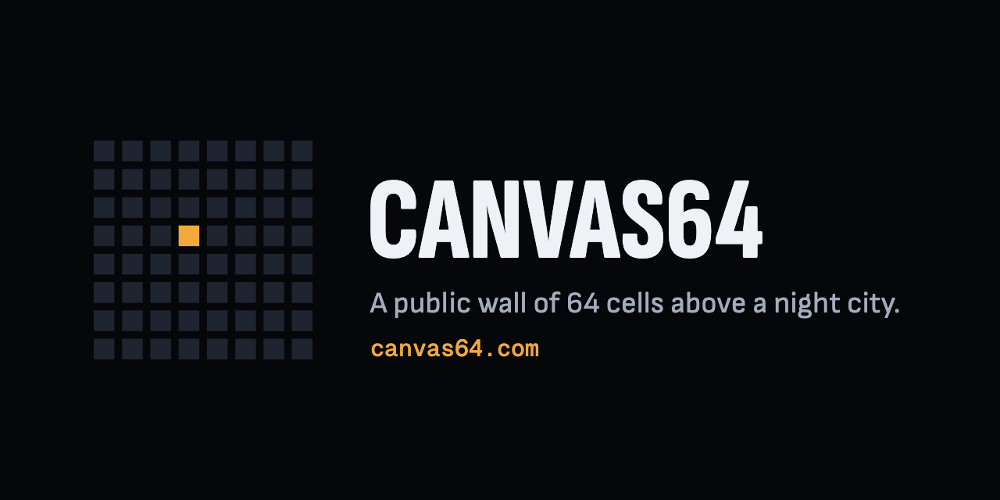

**A public wall of 64 cells above a night city.**

- Claim a free cell for $30. Your photo, your name and your links, in front of everyone who comes to the wall.
- Anyone can buy a cell out at the next price, 1.65 times the last. The owner can't refuse, and gets back more than they paid.
- Every earlier owner of a cell earns a royalty on each later sale of it, for good.
- The rules live in one contract on Base that nobody can change, and every sale pays everyone in the same moment.

[canvas64.com](https://canvas64.com)
